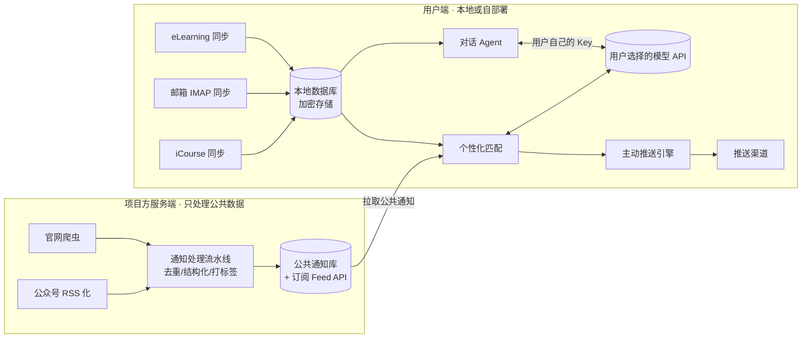

# Fudaner：复旦学生 AI 私人助理 · 产品需求文档（PRD）

> 版本：v0.1（草案） · 日期：2026-11-03 · 状态：待讨论
> 暂定名：**Fudaner**（仓库名 personal-assistant-fudaner，正式名称待定，备选：「旦旦」「旦小助」）

---

## 0. 一句话定义

**一个主动型的 AI 私人助理，对接复旦学生的 eLearning、复旦邮箱、iCourse 和校内通知，在合适的时间把真正和你有关的事告诉你。模型由用户自己接入（自带 API Key）。**

参考对象是 Muse、Dots 这类「有记忆、会主动找你」的个人助理。区别在于数据源和场景完全围绕复旦校园。

---

## 1. 背景与问题

### 1.1 复旦同学的信息现状

| 信息源 | 典型内容 | 现在的痛点 |
|---|---|---|
| **eLearning**（Canvas） | 作业、DDL、课程公告、课件、成绩、讨论 | 课程一多就要逐门点进去看，DDL 分散在各门课里，公告容易漏 |
| **复旦邮箱** | 院系通知、导师/助教来信、讲座邀请、系统邮件 | 信多且杂，重要邮件被淹没，常常不记得哪封要回 |
| **iCourse** | 课程回放、录播 | 回放很长，复习时找不到知识点在哪；缺课后不知道讲了什么 |
| **官网 / 公众号** | 教务处、研究生院、学工部、团委、就业中心、图书馆、院系、各类公众号 | 数量多、发布分散，跟自己有关的（奖学金、交换、讲座、竞赛、实习、选课节点）经常错过 |
| **课表 / 校历** | 上课时间地点、考试安排、调休 | 和其他日程割裂，调课调休要手动记 |

**核心问题：信息不缺，缺的是「过滤 + 时机」。** 学生需要一个能看完所有渠道、了解自己、只在该提醒的时候提醒的助手。

### 1.2 为什么是「主动型助理」而不是「又一个聚合 App」

- 只做聚合，只是把五个地方要刷的东西搬到一个地方，信息过载并没有减少。
- Muse/Dots 的关键在于：**有长期记忆、理解用户，并主动发起对话**。比如：「你周四有两个 DDL 撞在一起，数据结构那个估计要 6 小时，建议今晚先开始。」
- 复旦场景的数据结构化程度高（课程、作业、DDL、通知），非常适合做主动提醒。

### 1.3 为什么用户自带模型 API（BYOK）

- **成本**：学生项目无法承担全体用户的推理费用；BYOK 让产品可以免费开放。
- **隐私与信任**：用户的数据只发往用户自己选择的模型服务商，项目方不经手模型调用。
- **选择自由**：可以接 DeepSeek、通义千问、Kimi、智谱 GLM、Claude、OpenAI，或本地 Ollama。
- **代价**：上手门槛变高，效果因模型而异。需要靠引导流程和模型分级来弥补（见 §6）。

---

## 2. 目标用户与场景

### 2.1 用户画像

| 画像 | 描述 | 最在意 |
|---|---|---|
| **A. 课多的本科生** | 大二，一学期 8–10 门课，社团 + 实习 | 不漏 DDL、不漏选课/考试节点 |
| **B. 研究生** | 课少，科研和导师沟通多 | 邮件分拣、讲座/学术报告推荐、研究生院通知 |
| **C. 机会型同学** | 关注交换、奖学金、竞赛、实习 | 在截止前及时看到「和我有关」的机会 |
| **D. 技术型同学（早期种子用户）** | 愿意折腾 API Key、自己部署 | 可定制、开源、数据在自己手里 |

**冷启动先打 D 类用户，验证后主攻 A/C。**

### 2.2 核心场景（User Stories）

1. **早晨简报**：7:30 收到今日简报，包括今天的课（含教室）、24/72 小时内的 DDL、昨晚到现在的重要邮件、和我相关的新通知。
2. **DDL 守护**：作业发布后自动进入待办；按难度和剩余时间分级提醒；临近截止还没提交就升级提醒。
3. **邮件分拣**：「这周有哪些邮件需要我回？」→ 列出需要回复/行动的邮件，并可起草回复（发送前需我确认）。
4. **通知雷达**：我在画像里写了「对 CS 方向讲座、交换项目、量化实习感兴趣」，助手在教务处、学院官网、公众号中筛出匹配内容，附摘要和截止日期推给我。
5. **课程回放助手**：「上周三数分讲的一致连续的定义在回放第几分钟？」→ 定位片段并总结。
6. **自然对话**：「帮我把下周所有考试和 DDL 排个复习计划」「把这封英文邮件改得更正式」「学期还剩几周？」
7. **记忆**：我说过「周二晚上有社团活动别排任务」，之后安排计划时它会记得。

---

## 3. 产品定位与原则

### 3.1 定位

> **复旦版 Muse：一个懂复旦、懂你、会主动开口的私人助理。**

### 3.2 产品原则

1. **少打扰**：主动推送有频率上限和静默时段，每条推送都要能回答「为什么现在告诉我」。
2. **可解释**：每条提醒标注来源（链接到原通知/原邮件）和推荐理由（命中了哪个兴趣/哪门课）。
3. **只读优先，写操作必须确认**：默认只读。发邮件、提交内容等任何写操作都需要用户逐次确认。
4. **数据归用户**：凭据和个人数据默认存在本地或用户自己的部署中，可一键导出、一键清除。
5. **不越界**：不做抢课、刷课、自动签到、代写作业、自动提交作业等违反校规或学术诚信的功能。

---

## 4. 功能需求

优先级：**P0 = MVP 必须**，P1 = 第二阶段，P2 = 远期。

### 4.1 账号与数据源接入

| 功能 | 说明 | 优先级 |
|---|---|---|
| 模型配置（BYOK） | 支持 OpenAI 兼容协议的任意端点（Base URL + Key + 模型名）；内置常用厂商预设；支持「主模型 / 轻量模型 / 嵌入模型」三档分开配置；一键连通性测试 | P0 |
| eLearning 接入 | **首选 Canvas 个人 Access Token**（在 eLearning「设置」中生成，如学校开放该功能），走官方 REST API；备选：UIS 登录后的会话 Cookie | P0 |
| 复旦邮箱接入 | IMAP（只读拉取）+ SMTP（仅在用户确认后发送）；用户需在邮箱设置中开启 IMAP/客户端授权码（具体以学校邮箱实际设置为准） | P0 |
| 课表导入 | 从教务系统导出，或从 eLearning 课程列表推断，或手动导入 ICS/Excel | P0 |
| iCourse 接入 | UIS 会话登录，拉取已选课程的回放列表；如平台提供字幕/转写则直接用，否则可选本地语音转写 | P1 |
| 校历 | 内置当前学年校历（开学、考试周、假期、调休） | P0 |
| 外部日历 | 导出 ICS 订阅链接（可接入系统日历/Outlook/Google 日历） | P1 |

> ⚠️ 所有校内系统的接入方式都需要在开发前**实测验证**，并评估合规风险（见 §9）。

### 4.2 统一收件箱（Inbox）

- 把作业、课程公告、邮件、通知统一成「事项（Item）」卡片，带类型、来源、时间、截止、重要度。
- 筛选：按课程 / 按类型 / 只看需要行动的。
- 每张卡片可以：标记完成、稍后提醒、忽略同类、问助手（带着卡片上下文开对话）。
- **P0**

### 4.3 DDL 与待办

- 自动从 eLearning 作业、邮件正文、通知中**抽取截止时间**，生成待办（来自邮件或通知的结构化抽取需用户确认后入库，或以「建议」形式展示）。
- 多级提醒：默认提前 72h / 24h / 3h，可按课程调整。
- 识别「DDL 撞车」（同一天有 ≥2 个截止）并提前预警。
- 能从 Canvas 读到提交状态时，已提交的作业自动结束提醒。
- **P0**

### 4.4 每日简报 & 每周回顾

- **每日简报（P0）**：时间可设。内容依次为今日课程 → 紧急 DDL → 重要邮件 → 新的相关通知 → 一句今日建议。
- **每周回顾（P1）**：周日晚上发送。内容包括本周完成情况、下周 DDL 和考试、推荐关注的活动/机会。

### 4.5 邮件助手

| 能力 | 优先级 |
|---|---|
| 新邮件分类：需回复 / 需行动 / 通知 / 订阅 / 垃圾 | P0 |
| 重要邮件摘要，并抽取行动项与截止时间 | P0 |
| 起草回复（中英文、语气可选），**发送前需人工确认** | P1 |
| 按发件人设置规则（如：导师来信一律立即提醒） | P1 |
| 自然语言检索：「助教上个月发的期中范围」 | P1 |

### 4.6 通知雷达（主动推荐的核心）

**信息源（第一批，可配置、可扩展）：**

- 校级：教务处、研究生院、学生工作部、校团委、就业指导中心、图书馆、国际合作与交流处、信息化办公室
- 院系：用户所在院系 + 用户订阅的其他院系
- 微信公众号：复旦大学官方号、各院系/职能部门号（具体列表由用户和运营共同维护）

**采集方式：**

- 官网：定时抓取通知列表页（遵守 robots、限制频率、带缓存），解析标题、发布时间、正文、附件。
- 公众号：公众号没有公开 API，是最难的一环。候选方案按推荐顺序：
  1. 依托 RSS 化的开源方案（如自建 RSSHub / WeRSS 一类服务），由项目方集中维护；
  2. 用户在微信内「转发给助手」（分享链接 → 助手解析），作为兜底；
  3. 与相关公众号运营方/校内单位合作，获得授权的推送渠道（长期方向）。
- **公共通知是非个人数据，统一在服务端采集一次，供所有用户共享**；个性化匹配在用户端或用户自己的模型调用中完成。

**处理流水线：**

```
采集 → 去重（同一通知多渠道转发）→ 结构化（类型/对象/截止/地点/报名链接）
     → 打标签（讲座、奖学金、交换、竞赛、实习、选课、考试、讲座学分…）
     → 与用户画像匹配打分 → 决定：立即推送 / 进入简报 / 仅入库
```

**匹配打分（初版规则 + 模型混合）：**

```
score = w1·硬匹配（院系/年级/身份是否属于目标对象）
      + w2·兴趣相似度（标签 + 向量相似度）
      + w3·紧迫度（距截止时间）
      + w4·历史反馈（同类内容被点开/忽略的比例）
      − w5·打扰成本（今日已推送条数、静默时段）
```

- 硬匹配不通过的直接过滤，比如「仅限 2024 级研究生」而用户是本科生。
- 分数超过即时阈值才单独推送，否则进入简报。**P0 做规则 + 标签版，P1 加向量和反馈学习。**

### 4.7 兴趣画像与记忆

- **显式画像（P0）**：首次使用时填写院系、年级、专业、身份（本/硕/博/留学生），勾选兴趣标签，也可以用一句话自由描述。
- **隐式学习（P1）**：根据用户的点开、收藏、忽略、对话内容，更新兴趣权重。
- **长期记忆（P1）**：从对话中提取用户偏好和事实（「周二晚上不排任务」「在申请 MIT 交换」），用户可在「记忆」页面查看、编辑、删除每一条。
- 画像和记忆**完全可见、可编辑**，不做黑箱。

### 4.8 对话助手（基础 Personal Assistant 能力）

- 自然语言对话，可调用以下工具（Agent Tool Use）：
  - `search_items`：检索作业、公告、邮件、通知
  - `get_schedule`：查询课表和日程
  - `create_todo` / `set_reminder`：创建待办和提醒
  - `draft_email`：起草邮件（只生成草稿）
  - `search_course_replay`：检索课程回放片段（P1）
  - `get_calendar`：查询校历
- 通用能力：写作润色、翻译、总结文档或网页、学习计划制定、问答。
- 对话里提到的事项可以一键转为待办或提醒。
- **P0**：基础对话 + 检索 + 待办；**P1**：邮件草稿、回放检索、多步规划。

### 4.9 课程回放助手（iCourse）· P1

- 回放列表按课程整理，新回放上线时通知。
- 获取文字稿（平台自带字幕，或在用户本地用 Whisper 类模型转写）→ 分段 → 生成章节目录和摘要。
- 支持「在回放里搜知识点」，结果跳转到对应时间点。
- 回放内容只做**个人学习用途**，不对外分发，转写结果只存在用户本地（版权与课堂隐私）。

### 4.10 主动推送引擎

| 触发类型 | 例子 |
|---|---|
| 定时 | 每日简报、每周回顾 |
| 事件 | 新作业发布、导师来信、高匹配通知出现、成绩发布 |
| 时间临近 | DDL 前 N 小时、考试前 N 天、报名截止前 |
| 状态异常 | DDL 撞车、截止临近但未提交、连续多天未查看重要邮件 |

**打扰控制：**

- 静默时段（默认 23:30–7:30），紧急事项可以设白名单。
- 每日即时推送上限（默认 5 条），超出的进入下一次简报。
- 每条推送都附带「为什么推给我」和「以后少推这类」按钮。

**推送渠道**（按开发成本排序）：

1. App/PWA 内通知 + Web Push（P0）
2. 邮件摘要（P0，直接发到复旦邮箱）
3. 第三方推送桥：Bark（iOS）、Server 酱、Telegram Bot 等（P1，适合技术型用户）
4. 企业微信/飞书机器人（P1）
5. 微信服务号模板消息（P2，需要主体资质，建议与校内单位合作）

---

## 5. 信息架构与关键界面

```
┌──────────────────────────────────────────────┐
│  今日 │ 收件箱 │ 日程 │ 雷达 │ 对话 │ 我的    │
└──────────────────────────────────────────────┘
```

| 页面 | 内容 |
|---|---|
| **今日** | 今日简报卡片、今日课程时间线、紧急 DDL、助手主动发起的消息 |
| **收件箱** | 统一事项流（作业/公告/邮件/通知），支持筛选和批量处理 |
| **日程** | 周视图课表 + DDL + 考试 + 用户自建事件 |
| **雷达** | 通知推荐流（带匹配理由）、信息源订阅管理、兴趣标签 |
| **对话** | 与助手聊天，可引用任意卡片作为上下文 |
| **我的** | 数据源连接状态、模型配置、推送设置、画像与记忆、数据导出/删除 |

**首次使用引导（Onboarding）**，目标是 5 分钟内完成：

1. 选择模型厂商 → 粘贴 Key → 测试连通（附各家获取 Key 的图文教程）
2. 连接 eLearning（Token 或登录）
3. 连接邮箱（附开启 IMAP 的图文教程）
4. 填写院系、年级、兴趣标签
5. 立即生成第一份简报，让用户马上看到效果

---

## 6. 模型策略（BYOK）

### 6.1 模型分级

| 档位 | 用途 | 调用量 | 推荐 |
|---|---|---|---|
| 轻量模型 | 邮件/通知分类、打标签、抽取截止时间 | 高 | 便宜、快的小模型 |
| 主模型 | 对话、简报撰写、邮件草稿、规划 | 中 | 用户可承受的最强模型 |
| 嵌入模型 | 语义检索、兴趣匹配 | 高 | API 嵌入模型，或本地中文嵌入模型（如 bge 系列） |

只配了一个模型时，所有任务都用它，同时提示用户「配置轻量模型可以显著降低成本」。

### 6.2 成本控制

- 公共通知的结构化和打标签**由服务端统一做一次**（项目方承担，成本很低且与个人无关），用户端只做个性化匹配。
- 规则优先：能用正则或规则判定的（如 Canvas 作业本来就带截止时间）不调用模型。
- 缓存：同一内容只处理一次；简报增量生成。
- 用量面板：按天显示 token 用量和估算费用；支持设置每日/每月预算上限，超出后降级为纯规则模式。

### 6.3 兼容性

- 统一走 OpenAI 兼容接口；针对需要特殊处理的厂商做适配层。
- 工具调用（function calling）能力分级检测：不支持工具调用的模型降级为「检索后直接回答」模式。
- 内置一套评测集（分类准确率、截止时间抽取准确率），用户切换模型后可一键自测效果。

---

## 7. 技术架构（建议）

### 7.1 总体思路：公共层在服务端，个人层在本地



**这样设计的原因：**

- 学生的 UIS 账号、邮箱授权码、Canvas Token 等高敏感凭据**永远不上传到项目方服务器**，项目方几乎没有数据泄露风险。
- 公共通知集中采集，避免几千个用户各自去爬官网，对校方服务器更友好。
- 个人数据同步由用户端发起，请求来自用户本人的设备和会话，更接近正常使用行为。

### 7.2 形态选择

| 方案 | 优点 | 缺点 | 建议 |
|---|---|---|---|
| **桌面端**（Tauri/Electron）+ 后台常驻 | 本地优先，凭据安全，可以后台定时同步 | 手机上收不到推送，需要配合推送桥 | **MVP 首选** |
| 自部署 Web（Docker，部署在用户自己的服务器/NAS） | 手机端可以访问，适合技术型用户 | 门槛高 | MVP 同步提供 |
| 移动端 App | 体验最好，推送原生 | 后台定时同步受限，开发成本高 | P2 |
| 项目方托管云服务 | 门槛最低 | 需要托管学生凭据，合规和安全风险最大 | **暂不做**，除非取得学校授权 |

### 7.3 技术栈（参考）

- 后端/同步引擎：Python（FastAPI + APScheduler），或 TypeScript（Node）
- 本地存储：SQLite（SQLCipher 加密）+ sqlite-vec / LanceDB 做向量检索
- 凭据：操作系统钥匙串（Keychain / Windows Credential Manager / libsecret）
- 前端：React + Tailwind；桌面端用 Tauri 打包
- LLM 接入：OpenAI 兼容客户端 + 适配层
- 服务端爬虫：Python（httpx + selectolax）+ 任务队列，公众号走 RSS 化中间层

### 7.4 核心数据模型（简化）

```
Source        { id, type: elearning|mail|icourse|web|wechat, config, last_sync_at }
Item          { id, source_id, kind: assignment|announcement|email|notice|replay,
                title, body, url, published_at, due_at?, course_id?, raw }
Course        { id, name, teacher, schedule[], elearning_id?, icourse_id? }
Todo          { id, item_id?, title, due_at, status, reminders[] }
Notice        { id, origin, title, body, tags[], audience{school,grade,degree},
                deadline?, url, published_at }            # 公共层
Profile       { school, major, grade, degree, interests[{tag, weight}], free_text }
Memory        { id, content, source: chat|manual, created_at, pinned }
Notification  { id, item_id?, reason, channel, sent_at, feedback }
```

---

## 8. MVP 范围与路线图

### 8.1 MVP（目标：本学期内 8 周，面向 50–100 名种子用户）

**必须有：**

- [ ] BYOK 模型配置（OpenAI 兼容 + 3–5 家预设）
- [ ] eLearning 同步：课程、作业、DDL、公告
- [ ] 复旦邮箱 IMAP 同步 + 分类 + 摘要
- [ ] 课表与校历
- [ ] 统一收件箱 + DDL 提醒
- [ ] 每日简报（App 内 + 邮件）
- [ ] 通知雷达：10–20 个官网信息源 + 标签匹配
- [ ] 基础对话：能检索自己的事项、创建待办
- [ ] 显式兴趣画像
- [ ] 数据导出与一键清除

**MVP 明确不做：** iCourse、公众号、长期记忆自动提取、邮件发送、移动 App。

### 8.2 路线图

| 阶段 | 时间（建议） | 内容 |
|---|---|---|
| **M0 技术验证** | 第 1–2 周 | 逐个验证 eLearning API/Token、邮箱 IMAP、教务课表、官网抓取的可行性，产出「接入可行性报告」 |
| **M1 MVP** | 第 3–8 周 | 上述 MVP 功能，桌面端 + 自部署 Web |
| **M2 主动性增强** | 第 9–14 周 | 公众号接入、反馈学习、长期记忆、每周回顾、邮件草稿、更多推送渠道 |
| **M3 学习助手** | 下学期 | iCourse 回放摘要与检索、复习计划、考试周模式 |
| **M4 生态** | 远期 | 社团/院系信息源自助入驻、开放插件、与校内单位合作争取官方授权 |

---

## 9. 合规、安全与风险

> 这是本项目**最需要认真对待**的部分，建议上线前咨询学校信息化办公室，并阅读相关校规。

| 风险 | 说明 | 应对 |
|---|---|---|
| **账号凭据安全** | 涉及 UIS 账号、邮箱授权码 | 凭据只存在用户本地钥匙串；优先使用权限更小的 Token/授权码，而不是 UIS 主密码；代码开源，接受审计 |
| **违反学校信息系统使用规定** | 自动化访问校内系统可能被视为违规 | 只读、低频（如每 15–30 分钟一次）、模拟正常用户行为；不做批量和高并发；主动与信息办沟通，争取备案或官方 API |
| **对校方服务器的压力** | 大量用户同时爬取 | 公共通知集中采集；个人同步设置全局最低间隔 + 随机抖动 |
| **个人信息保护** | 《个人信息保护法》等要求 | 项目方服务端不收集个人数据；隐私政策写清数据流向；用户数据可导出、可删除 |
| **数据发往第三方模型** | 邮件、作业内容会发给用户选择的模型商 | 首次配置时明确告知；支持本地模型；支持按来源设置「不发给模型」（如某些敏感邮箱文件夹） |
| **微信公众号抓取** | 有违反平台规则的风险 | 优先用转发兜底和合作授权；中间层由项目方控制频率；随时可下线该功能 |
| **课程内容版权与课堂隐私** | iCourse 回放、课件 | 只做个人学习用途，转写结果只存本地，不提供分享和导出 |
| **学术诚信** | 用户可能用助手代写作业 | 产品不提供「自动完成/提交作业」功能；对话中不主动代做作业，以讲解和规划为主 |
| **提示词注入** | 邮件或通知正文里可能夹带恶意指令 | 外部内容统一作为「数据」注入上下文，不作为指令；写操作必须人工确认；工具权限最小化 |
| **平台改版导致接口失效** | 校内系统随时可能升级 | 接入层插件化；健康检查 + 失效告警；社区共同维护 |

---

## 10. 成功指标

| 类别 | 指标 | MVP 目标 |
|---|---|---|
| 激活 | 完成引导（模型 + 至少 1 个数据源）的比例 | ≥ 60% |
| 留存 | 第 4 周周留存 | ≥ 40% |
| 价值 | 用户反馈「因助手而没漏掉 DDL/机会」的次数 | 每周人均 ≥ 1 |
| 推送质量 | 即时推送点开率 | ≥ 35% |
| 推送质量 | 「以后少推这类」点击率 | ≤ 10% |
| 准确性 | DDL 抽取准确率（人工抽检） | ≥ 95% |
| 准确性 | 通知硬匹配误推率（推给了不符合对象的人） | ≤ 5% |
| 成本 | 用户日均模型花费（推荐配置下） | ≤ ¥0.5 |

---

## 11. 待讨论问题（Open Questions）

1. **形态优先级**：MVP 先做桌面端还是自部署 Web？目标用户主要在手机上看信息，推送链路怎么设计最顺？
2. **公众号方案**：是否投入资源自建 RSS 化中间层，还是先只做「转发给助手」？
3. **是否主动联系学校**：信息化办公室 / 学生会 / 团委，争取官方授权或合作？这决定了能否走托管云服务。
4. **开源策略**：是否完全开源（有利于信任和社区维护接入层），还是开源客户端、闭源服务端？
5. **模型门槛**：是否需要提供少量「体验额度」（例如项目方赞助的小额度），降低第一次使用的门槛？
6. **研究生 vs 本科生**：MVP 的信息源和功能侧重哪一类用户？
7. **名称与品牌**：避免使用学校官方标识，名称需要体现「学生自制、非官方」。

---

## 附录 A：每日简报样例

> **☀️ 早上好，11 月 4 日 周二 · 第 9 周**
>
> **今日课程**
> - 08:00 数学分析 III · H3109
> - 13:30 数据结构 · H2215
>
> **⏰ 紧急 DDL**
> - 🔴 **今晚 23:59**：数据结构 Lab 5（eLearning，尚未提交）
> - 🟡 周四 12:00：大学物理 习题 8
> - ⚠️ 周四有 2 个截止，建议今晚开始物理习题
>
> **📧 需要你处理的邮件（2）**
> - 王老师：「关于下周组会时间调整」→ 需要回复是否可以参加
> - 教务处：期中考试安排确认 → 已加入日程
>
> **📡 可能和你有关**
> - 【讲座】计算机学院 · 大模型推理加速前沿（周五 14:00）· *匹配：你关注「AI」「CS 讲座」*
> - 【交换】2027 春季赴新加坡交换项目报名 · 截止 11/15 · *匹配：你关注「交换」，你的年级符合条件*

## 附录 B：术语

- **BYOK**：Bring Your Own Key，用户自带模型 API Key
- **UIS**：复旦统一身份认证
- **eLearning**：复旦基于 Canvas 的教学平台
- **iCourse**：复旦课程回放/在线课程平台
- **事项（Item）**：本产品中统一抽象的一条信息（作业、公告、邮件、通知、回放）
